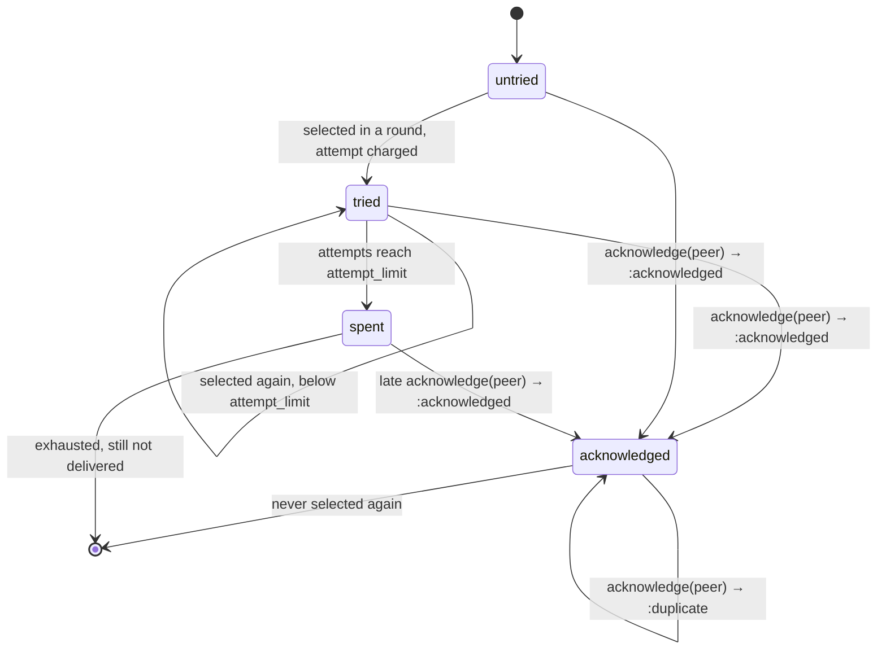
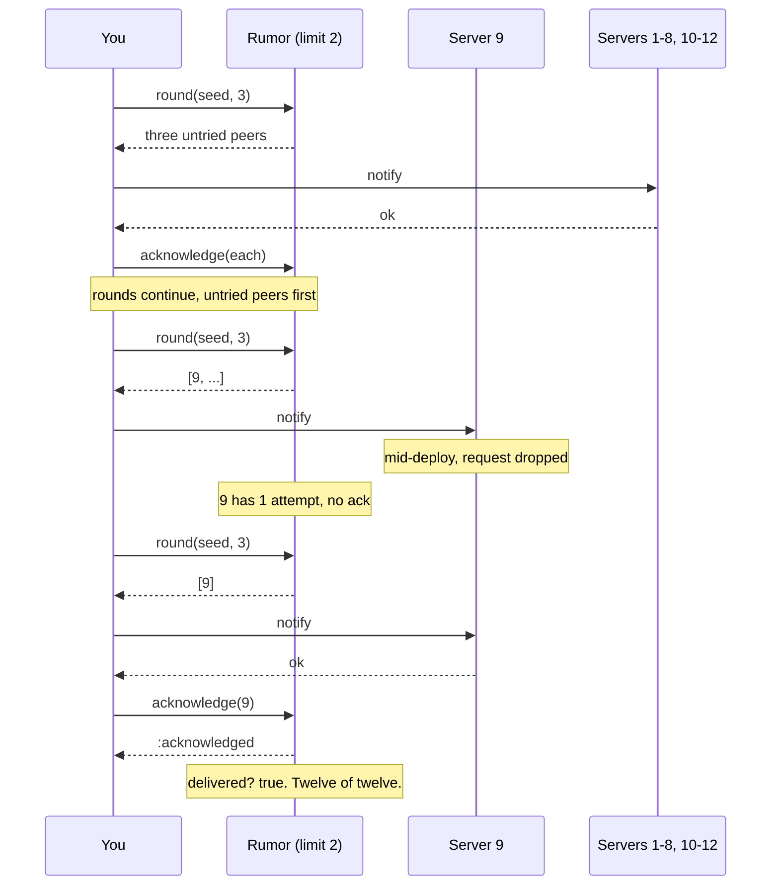

# GossipMachines

> Running out of retries is not the same as being heard. 📡

A rumor planner for Ruby. You give it the peers that need to hear something and how many times you're willing to try each one. Every round it picks who to send to next, favoring the peers you've tried least. You report back who acknowledged. It keeps those two books, attempts and acknowledgements, strictly apart, so "I've stopped sending" and "everyone got it" never get confused for each other.

## Quick Start

```bash
gem 'gossip_machines'
```

```ruby
rumor = GossipMachines::Rumor.new(node_ids, 3)   # peers, attempt_limit

until rumor.delivered? || rumor.exhausted?
  rumor.round(rand(2**32), 3).each do |peer|     # seed, fanout
    rumor.acknowledge(peer) if transport.send(peer, payload)
  end
end

rumor.delivered?   # => true if every peer acknowledged
rumor.exhausted?   # => true if nobody is eligible for another send
```

If the loop ends with `delivered?` false, you know exactly which peers never answered. Ask `status`.

## A Message to the Resistance

So you rolled a new feature flag and told every app server about it. Fired a request at each one, didn't wait around, logged "broadcast complete". Twelve servers took the flag. Server nine was mid-deploy and dropped the request on the floor.

For the next six hours server nine served the old behavior to one twelfth of your users, and your dashboard said the rollout was done. Because "I sent it" got written down as "they have it".

The fix is two ledgers. One counts how many times you've tried each peer. The other records who actually said yes. The rollout is done when the second ledger is full. When the first ledger runs dry and the second one isn't full, you have a list of names, not a success message.

This gem is those two ledgers, plus the part that decides who to try next.

## Chapter 1: Stardate 2025.186, the AMS Demers

> **AMS Demers**, NCC-4210, *Demers*-class relay vessel.
> Spread the signal. Do not mistake exhausted transmissions for delivered orders.

The relay doesn't carry the message. It keeps the roster: which ships have been hailed, how many times, and which have confirmed. Each transmission window it names as many ships as the signal officer has channels, the ones hailed least, and hands them to the signal officer. A ship that never confirms stays on the roster until its hail budget is spent. Even then, it stays on the roster as unconfirmed. The relay never promotes silence to receipt.

Somewhere on the bridge, an ensign proposes:

```ruby
def broadcast(flag)
  servers.each { |s| s.notify(flag) rescue nil }
  log.info "broadcast complete"
end
```

"That," says the signal officer, "is how one ship fights yesterday's war."

## The Flight Plan

Every peer is in one of three states, and only one of them is good news.



And the flag rollout, the day server nine was mid-deploy:



## How a Rumor Spreads

### Rounds

`round(seed, max)` takes a seed and the most peers you can send to right now, and returns an Array of at most `max` peer ids. Peers never repeat within a round, and selecting a peer charges one attempt against it immediately. Fewer than `max` eligible peers gives a shorter Array; none gives `[]`.

```ruby
rumor = GossipMachines::Rumor.new([10, 20, 30, 40, 50], 2)

rumor.round(1, 3)    # => [30, 50, 20]
rumor.round(1, 3)    # => [10, 40, 30]
rumor.round(1, 3)    # => [50, 20, 10]
rumor.round(1, 3)    # => [40]
rumor.round(1, 3)    # => []
```

Five peers, two attempts each, ten sends total. Notice the second round reaches for 10 and 40, the two nobody had tried yet, before giving 30 its second go. Fewest attempts always rank first. The seed only settles ties, so the same seed gives the same order every time.

A round is a dispatch, not a request that can be turned down. The attempts it charges are exactly the peers it returns, one each, and it counts nothing else: there is no round counter. So a round that returns `[]`, because everyone acknowledged, everyone is spent, the roster is empty or `max` is 0, charges nobody and changes nothing. Call it as often as you like.

### Acknowledgements

When a peer confirms, say so. The first time answers `:acknowledged`. Saying it again answers `:duplicate`: honoured, already true, nothing changed. A stranger is refused with `:unknown_peer`, and nothing changed either.

```ruby
rumor = GossipMachines::Rumor.new([10, 20, 30, 40, 50], 2)
rumor.round(99, 3)     # => [50, 30, 40]

rumor.acknowledge(10)  # => :acknowledged
rumor.acknowledge(20)  # => :acknowledged
rumor.acknowledge(20)  # => :duplicate, it already had
rumor.acknowledge(77)  # => :unknown_peer, not on the roster

rumor.round(99, 3)     # => [50, 30, 40]  10 and 20 are done, never selected again
rumor.status(10)       # => #<data GossipMachines::Status attempts=0, acknowledged=true>
rumor.status(30)       # => #<data GossipMachines::Status attempts=2, acknowledged=false>
```

An acknowledged peer drops out of every future round. You can acknowledge a peer you never sent to; maybe it heard from someone else. That's gossip. An acknowledgement never touches the attempt count.

### Delivered is not exhausted

These two answer different questions and you need both.

```ruby
rumor = GossipMachines::Rumor.new([10, 20], 1)
rumor.round(0, 3)     # => [10, 20]

rumor.exhausted?      # => true   nobody has attempts left
rumor.delivered?      # => false  nobody has confirmed

rumor.acknowledge(10)
rumor.acknowledge(20)
rumor.delivered?      # => true
```

`exhausted?` tells you `round` has nothing left to give: every further round is `[]`. `delivered?` tells you the rollout is done. The gap between them is your list of peers to escalate.

### Status and roster

```ruby
rumor = GossipMachines::Rumor.new([0, 2**64 - 1], 1)
rumor.peers              # => [0, 18446744073709551615]
rumor.status(0)          # => #<data GossipMachines::Status attempts=0, acknowledged=false>
rumor.status(0).attempts # => 0
rumor.status(1)          # => nil, not a peer
rumor.attempt_limit      # => 1
rumor.capacity           # => 64
```

`status` answers a `GossipMachines::Status`, a frozen `Data` with the same two fields as the core's `Status`. `peers` and `round` hand back fresh arrays. Mutate them freely, the rumor doesn't notice.

### Nobody to tell

An empty roster is both delivered and exhausted from the start, and rounds come back empty.

```ruby
empty = GossipMachines::Rumor.new([], 1)
empty.delivered?      # => true
empty.exhausted?      # => true
empty.round(0, 3)     # => []
```

## The Rules of the Relay

- **Up to 64 peers** per rumor, exposed as `Rumor::MAX_PEERS` and `capacity`. Fanout is yours: `round(seed, max)` returns at most `max` peers.
- **Ruby mirrors the core.** `Rumor.new(peers, attempt_limit)` takes the same two arguments in the same order as the Rust constructor, positionally, with no defaults. `status` answers the core's `Status` as a `Data`. Peer ids are the core's `NodeId`, plain Integers you choose.
- **Peer ids, seeds and `max` are Integers** in `0..2**64-1`. **Attempt limits** are Integers in `1..2**32-1`. Floats, strings, nil, and objects with `to_int` raise `TypeError`. Out of range raises `RangeError`.
- **`peers` must be a real Array** with no duplicates; it may be empty. Duplicates, more than 64 peers, or the wrong number of arguments raise `ArgumentError`.
- **Refusals don't raise.** `:unknown_peer` is an answer, and a refused call changes nothing. Only malformed input raises.
- **Repeats are honoured.** Acknowledging a peer that already acknowledged answers `:duplicate`. The rumor can prove it from that peer's own ledger, so it is a success that changes nothing, never a refusal.
- **An empty round is an answer, not a refusal.** `round` charges exactly the peers it returns. `[]` charges nobody and changes nothing.
- **Every answer, by method.**

  | Method | Honoured | Refused |
  | --- | --- | --- |
  | `round(seed, max)` | an Array of at most `max` peer ids, each charged one attempt; `[]` when nobody is eligible | never refuses |
  | `acknowledge(peer)` | `:acknowledged`, or `:duplicate` when the peer had already acknowledged | `:unknown_peer` |
  | `status(peer)` | a `Status`, or `nil` for a peer not on the roster (a query) | never refuses |
- **No ids are issued, no clock is read.** Peer ids come from you, so there are no scopes and nothing to resume after a restart except what you saved yourself. Time between rounds is yours.
- **Bad input charges nothing.** A `round` that raises on its seed or `max` leaves every attempt counter where it was.
- **Frozen means frozen.** `freeze` the rumor and `round` and `acknowledge` raise `FrozenError`, even for an unknown peer or an exhausted roster. `status`, `peers`, and the predicates still read.

## What You Think You're Doing vs Reality

### You Think: "I retried three times, so it's delivered."
### Reality: You stopped. That's all three retries proves.

Retry budgets protect you from hammering a dead peer forever. They say nothing about whether the live ones heard you. The only evidence of delivery is an acknowledgement, and the only honest end state is one where every peer has produced one.

## What's Yours

The rumor plans; it doesn't send. You own the transport, the payload, the retry timing between rounds, and the decision about what to do with peers that are spent and silent. Leave yourself off the peer list. Make sure an acknowledgement really came from that peer, for this rumor, before you record it: the id is a roster entry, not a credential.

## License

MIT License. See [LICENSE.txt](LICENSE.txt) for details.

**Remember: Server nine never got the memo, and the dashboard said it did.**
